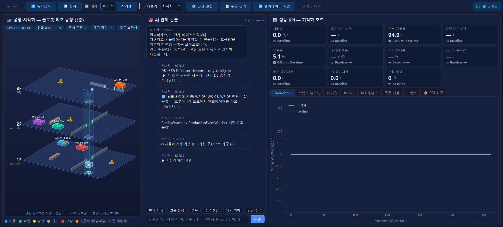
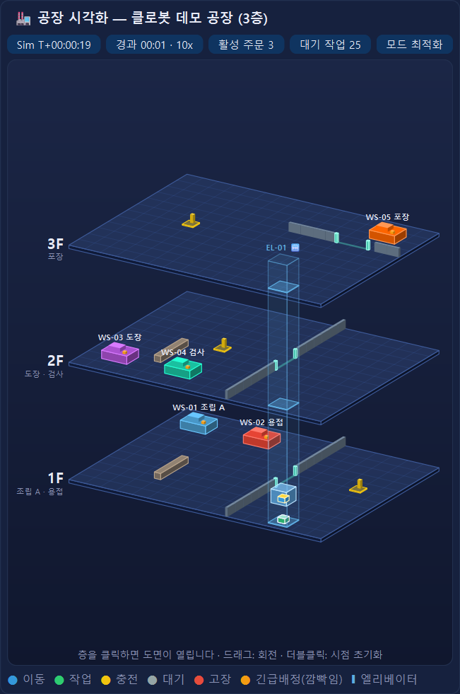
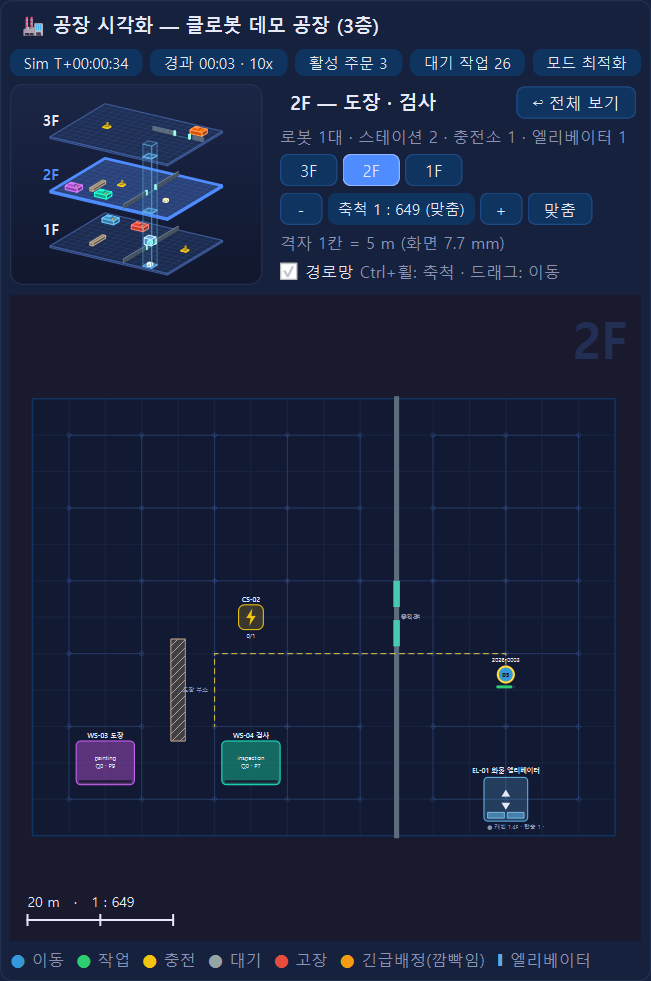
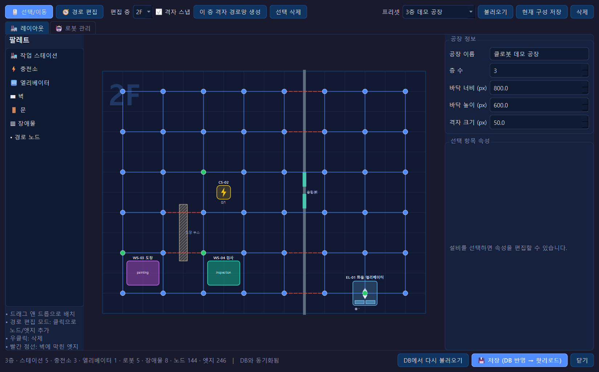
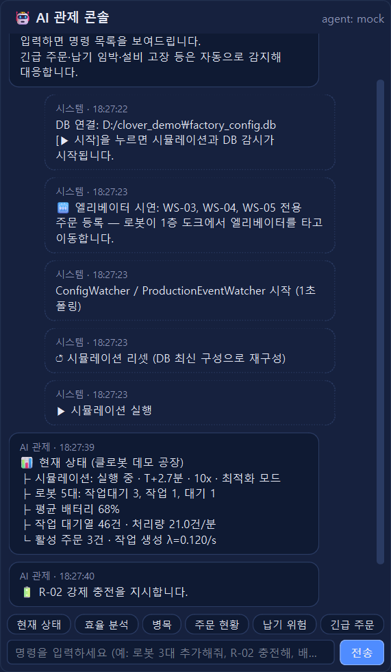
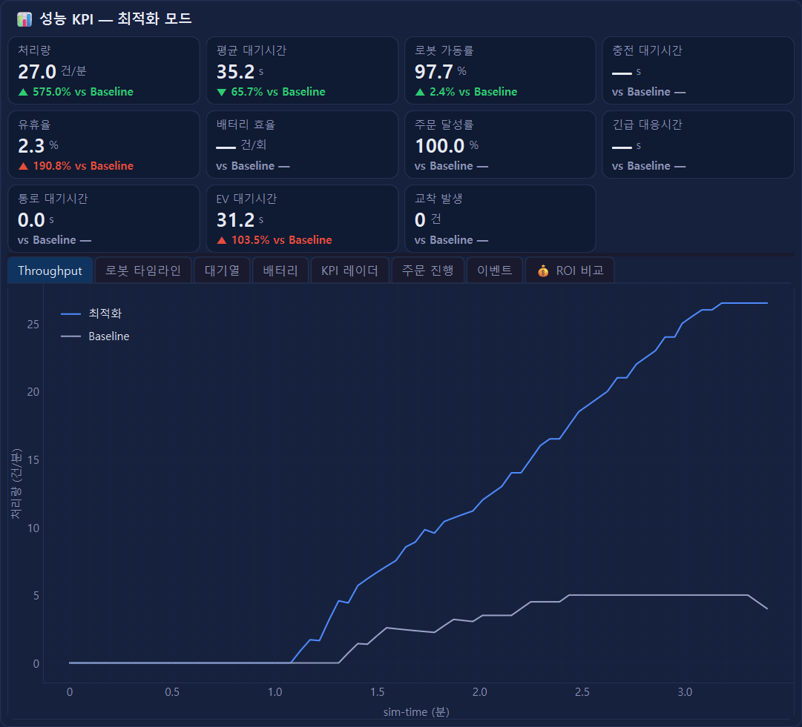
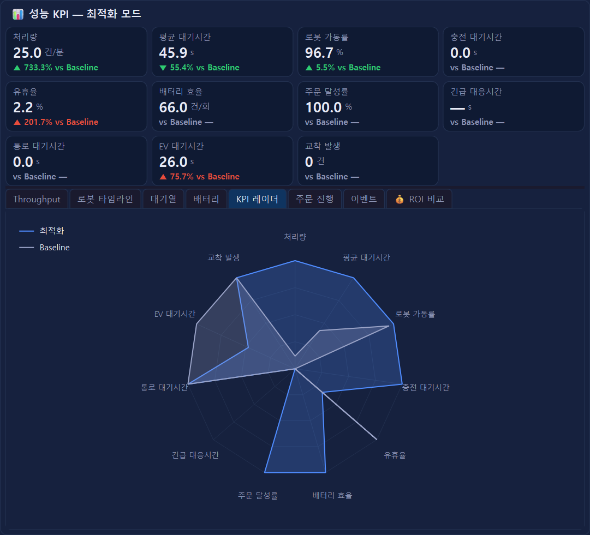
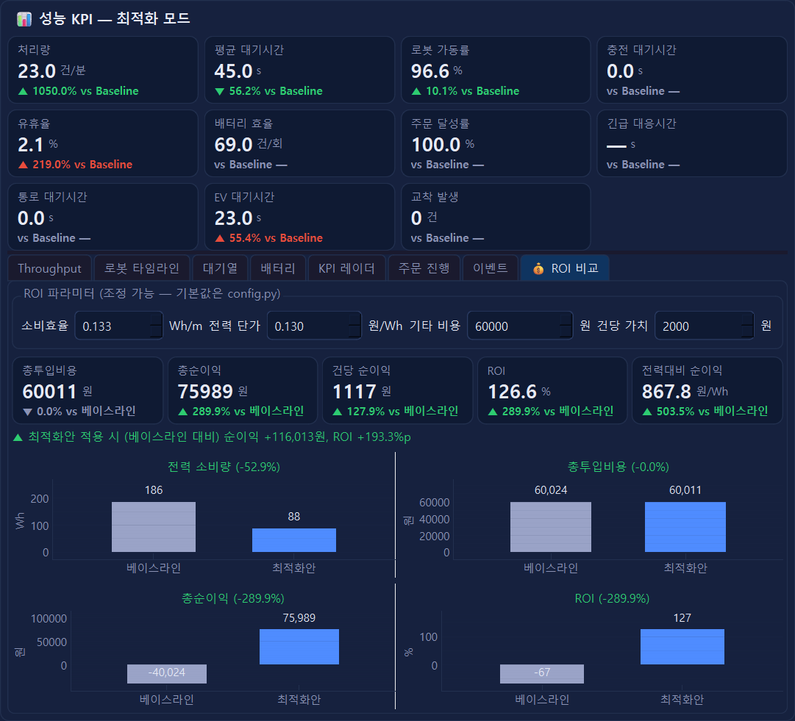

# 🤖 Robot Factory Simulator

> **SimPy 기반 멀티로봇 공장 시뮬레이터 + AI 대화형 관제 시스템**  
> IC-PBL 캡스톤 디자인 2 — 클로봇(Clobot) 제안 주제

---

## 📌 프로젝트 개요

제조 현장의 멀티로봇 작업 배정 및 충전 스케줄링을 최적화하는 시뮬레이션 플랫폼입니다.  
납품 업체가 자사 공장 환경(설비 배치, 로봇 수, 충전기 등)을 설정하면 DB에 저장되고, 시뮬레이터에 **실시간 반영**됩니다.  
AI 관제 콘솔을 통해 자연어로 시뮬레이션을 제어하고, 긴급 생산 상황에 자율적으로 대응합니다.

> 📘 **처음 사용하시는 고객(납품 업체) 담당자**는 [제품 사용 설명서](docs/USER_MANUAL.md)부터 읽어주세요.

### 주요 기능
| 영역 | 내용 | 자세히 |
|---|---|---|
| 시뮬레이션 | SimPy 멀티로봇 공장 + Baseline / 최적화 스케줄러 병렬 비교, DB 핫리로드 | [KPI](docs/FEATURES.md#-성능-지표-kpi) |
| 다층 공장 · 3D | 최대 6층, 층별 도면, 엘리베이터 이동, 3D 건물 개요 → 층 도면 전환, 축척(1:N) 조절 | [다층 공장](docs/FEATURES.md#-다층-공장--3d-건물--엘리베이터) |
| 물리 제약 | 통로 폭(차선), 교차점, 엘리베이터 대기, 교착 지표 + 레이아웃·난이도 시나리오 | [물리 제약](docs/FEATURES.md#-물리-제약-시나리오) |
| AI 관제 · RAG | 규칙 기반 관제 콘솔 + 문서/로그 검색(RAG, 로컬 기본) | [RAG](docs/FEATURES.md#-rag-문서-검색-관제) |
| 운영안 비교 (MILP) | 베이스라인 vs MILP 배정안을 같은 조건으로 반복 실험, 추천·근거 설명 | [운영안 비교](docs/FEATURES.md#-운영안-비교-milp) |
| ROI | 이동거리·완료 건수·비용 파라미터로 수익성 계산, 베이스라인 vs 최적화안 그래프 | [ROI](docs/FEATURES.md#-roi-수익성-계산) |

### 핵심 가치
| | Baseline (기존) | 본 솔루션 (최적화) |
|---|---|---|
| 작업 배정 | 라운드로빈(순서대로) | 배터리·거리·큐·납기 가중합 최적 배정 |
| 충전 스케줄링 | 배터리 소진 시 충전 | 예측 기반 선제 충전 + 긴급 시 최소충전 복귀 |
| 설비 변경 대응 | 시뮬레이션 재시작 필요 | DB 핫리로드, 무중단 반영 |
| 긴급 주문 대응 | 수동 재배치 | AI 자율 판단 + 자동 로봇 재배치 |

---

## 🖥️ 화면 구성

```
┌─────────────────────────────────────────────────────────────────┐
│ [▶ 시작] [⏸] [⏹] [⏩ 배속] [리셋] │ ⚙ 공장 설정 │ 📋 주문 │ 🛗 시연 │ DB: ● │
├───────────────────┬──────────────────┬──────────────────────────┤
│  3D 건물 개요      │                  │   KPI 카드               │
│   ↕ 층 클릭        │  AI 관제 콘솔     ├──────────────────────────┤
│  층별 도면         │  (Chat Console)  │   실시간 그래프 (8탭,     │
│  (Factory Floor)  │                  │   ROI 비교 탭 포함)       │
├───────────────────┴──────────────────┴──────────────────────────┤
│  🔴 긴급 생산 알림 배너 (이벤트 발생 시에만 표시)                  │
└─────────────────────────────────────────────────────────────────┘
```

### 좌측 — 공장 시뮬레이터 시각화
- **3D 건물 개요**: 층 바닥판을 쌓은 등각 투영 모델. 층을 클릭하면 건물이 왼쪽 위로 줄어들며 그 층의 **2D 도면**이 열림 ([자세히](docs/FEATURES.md#-다층-공장--3d-건물--엘리베이터))
- 2D 공장 바닥 뷰 (QGraphicsScene), Ctrl+휠로 축척(1:N) 조절
- 작업 스테이션, 충전소, 엘리베이터, 로봇, 벽/문/장애물을 DB 기반으로 동적 렌더링
- 로봇 상태별 색상: 이동(파랑), 작업(초록), 충전(노랑), 대기(회색), 고장(빨강), 긴급배정(주황 깜빡임)
- 로봇 배터리 잔량 바 + 이동 경로 점선 애니메이션

### 중앙 — AI 대화형 관제 콘솔
- 자연어 명령으로 시뮬레이션 제어 (로봇 추가/충전/배속 변경 등)
- 긴급 주문 투입, 설비 고장 처리, 병목 분석 등
- AI가 긴급 상황 자동 감지 → 자율 대응 → 결과 보고

### 우측 — 성능 대시보드
- KPI 카드 (Baseline 대비 증감률 표시)
- 8개 탭 차트: Throughput 비교, 로봇 상태 타임라인, 대기열 추이, 배터리 추이, 레이더 비교, 주문 진행률, 이벤트 타임라인, **💰 ROI 비교**

---

## 🖼️ 화면 미리보기

| | |
|:-:|:-:|
| <br>**전체 화면 (3층 데모 공장)** | <br>**3D 건물 개요 · 엘리베이터** |
| <br>**층 도면 (2F) · 축척 1:N** | <br>**공장 설정 에디터 (층별 편집)** |
| <br>**AI 관제 콘솔** | <br>**성능 KPI · 처리량** |
| <br>**KPI 레이더 (Baseline vs 최적화)** | <br>**ROI 비교** |

---

## 🗂️ 디렉토리 구조

```
robot_factory_sim/
├── main.py                        # 앱 진입점
├── requirements.txt               # Python 의존성
├── config.py                      # 시뮬레이션 기본 파라미터 + DB 경로 + RAG/ROI 설정
├── database/
│   ├── schema.sql                 # DB 스키마 정의 (v4: 층, 엘리베이터, 통로 폭 등)
│   ├── db_manager.py              # SQLite CRUD + changelog 기록 + 마이그레이션
│   ├── config_watcher.py          # ConfigWatcher (DB 변경 폴링)
│   ├── order_manager.py           # 생산 주문 CRUD + EventWatcher
│   ├── seed_data.py               # 3층 데모 시드 + 물리 제약 시나리오 프리셋
│   └── api_stub.py                # REST API 클라이언트 스텁
├── simulation/
│   ├── engine.py                  # SimPy 시뮬레이션 엔진 (GUI 없이 단독 실행 가능)
│   ├── sim_worker.py              # SimWorker(QThread) — Baseline·최적화 엔진 병렬 실행
│   ├── factory_service.py         # GUI용 공장 구성/주문 서비스 (gui → database 직접 참조 방지)
│   ├── state.py                   # SimState 스냅샷 + 에이전트 컨텍스트 변환
│   ├── robot.py                   # Robot 프로세스 (통로 차선·교차점·엘리베이터 탑승)
│   ├── station.py                 # WorkStation, ChargingStation
│   ├── elevator.py                # Elevator (층간 이동 SimPy 자원)
│   ├── corridor.py                # CorridorNetwork (통로 차선 / 교차점 공유자원)
│   ├── scheduler.py               # BaselineScheduler, OptimizedScheduler
│   ├── milp_scheduler.py          # RollingMilpScheduler (SciPy HiGHS MILP 배정)
│   ├── comparison.py              # 운영안 비교 실험 (베이스라인 vs MILP)
│   ├── event_export.py            # 생산 이벤트 JSONL 내보내기 (RAG 자료용)
│   ├── task_generator.py          # 작업 생성기 (주문 기반 하이브리드)
│   └── path_graph.py              # 층별 경로 그래프 + 엘리베이터 수직 구간 + Dijkstra
├── agent/
│   ├── base.py                    # BaseAgent ABC
│   ├── mock_agent.py              # MockAgent (규칙 기반)
│   ├── rag_agent.py               # RAG 연동 관제 에이전트
│   ├── orchestration.py           # 운영안 비교 대화 흐름 (/최적화, /추천 ...)
│   ├── models.py                  # 데이터 모델
│   └── rag/                       # 로컬 RAG (ChromaDB, 로더, CLI, 운영 기준 문서)
├── gui/
│   ├── main_window.py             # 메인 윈도우
│   ├── factory_panel.py           # 공장 시각화 패널 (정보 칩 + FloorStage + 범례)
│   ├── floor_stage.py             # 3D 건물 ↔ 층 도면 전환 무대 (축소 이동 애니메이션)
│   ├── building_view.py           # 3D(등각 투영) 건물 뷰
│   ├── factory_view.py            # 층별 2D 도면 (Ctrl+휠 축척, 축척 막대)
│   ├── console_panel.py           # 관제 콘솔
│   ├── dashboard_panel.py         # KPI + 차트 대시보드 (ROI 탭 포함)
│   ├── optimization_panel.py      # 운영안 비교 창 (비교 조건 · 결과 · 검증 범위)
│   ├── config_editor.py           # 공장 설정 에디터 (층 선택, 엘리베이터 배치)
│   ├── order_dialog.py            # 주문 관리 다이얼로그
│   ├── alert_banner.py            # 긴급 알림 배너
│   ├── agent_bridge.py            # AgentBridge(QThread) — 에이전트 실행 스레드
│   ├── constants.py               # 색상/크기/문구 상수
│   ├── widgets/
│   │   ├── kpi_card.py
│   │   ├── chat_bubble.py
│   │   ├── robot_item.py
│   │   ├── station_item.py
│   │   ├── elevator_item.py
│   │   ├── obstacle_item.py
│   │   └── roi_panel.py           # ROI 파라미터 입력 + 비교 차트
│   └── styles/
│       └── theme.qss              # 다크 테마
└── utils/
    ├── metrics.py                 # KPI 계산 (통로/EV 대기, 교착 포함)
    ├── event_types.py             # 이벤트/동작 타입 상수
    ├── config_models.py           # 공장 구성·주문 dataclass (층, 엘리베이터 포함)
    ├── layout_tools.py            # 층별 격자 경로망 생성, 설비↔노드 연결
    ├── comparison_models.py       # 운영안 비교 조건·비용 모델
    ├── roi.py                     # ROI 계산
    └── roi_chart.py               # ROI 비교 그래프 (matplotlib)
docs/
├── images/                        # README 화면 캡처
├── USER_MANUAL.md                 # 제품 사용 설명서 (고객용)
├── FEATURES.md                    # 기능 상세 (다층·물리·RAG·MILP·ROI·KPI)
├── RAG_POLICY.md                  # RAG 구축·적용 가이드라인
├── RAG_GUI_OPTIMIZATION.md        # 운영안 비교(MILP) 사용 가이드
└── USER_SCOPE_TEMPLATE.md         # 사용자 범위 양식
```

### 스레드 구성
| 스레드 | 역할 |
|---|---|
| 메인 (Qt GUI) | 화면 렌더링, 사용자 입력 |
| SimWorker | SimPy 실행 — Baseline·최적화 엔진을 같은 시드로 나란히 돌려 KPI 동시 비교 |
| ConfigWatcher | `config_changelog` 1초 폴링 → 설정 핫리로드 |
| ProductionEventWatcher | `production_events` 1초 폴링 → AI 자율 대응 |
| AgentBridge | 관제 에이전트 실행 (LLM 에이전트로 교체해도 GUI가 멈추지 않음) |

스레드 간 통신은 모두 Qt Signal/Slot으로 한다. 기본 정책은 가중치 휴리스틱이며 FIFO와 함께 실행한다. 툴바에서 RH-MILP 또는 RH-CP-SAT을 새로 활성화하면 선택한 RH 하나를 추가하고 공통 초기 상태에서 다시 시작한다. 이미 활성인 정책 선택은 **화면 표시·AI 조치 대상 엔진**만 바꾼다. RH 설정·예약·독립 비교·재현 방법은 [Rolling Horizon 가이드](docs/ROLLING_HORIZON.md)를 따른다.

---

## ⚙️ 설치 & 실행

### 요구사항
- Python 3.11+
- 운영체제: Windows / macOS / Linux

### 설치
```bash
git clone <repo-url>
cd CLOVER/robot_factory_sim
pip install -r requirements.txt
```
> Windows에서 PySide6 설치가 긴 경로 문제(`OSError: [Errno 2] ...`)로 실패하면 Windows 긴 경로 지원을 켜거나, 경로가 짧은 가상환경(예: `C:\venv`)에 설치하세요.

### 실행
```bash
python main.py
```
- 최초 실행 시 `factory_config.db`가 자동 생성되고 **3층 데모 공장**(스테이션 5개, 충전소 3개, 엘리베이터 1대, 로봇 5대)이 삽입됩니다. 이전 버전의 DB는 열 때 자동으로 마이그레이션됩니다.
- 툴바 **[🛗 엘리베이터 시연]** 을 누르면 2층 이상 스테이션 전용 주문을 넣고 로봇이 1층 도크에서 엘리베이터를 타고 이동하는 모습을 볼 수 있습니다.
- GUI 창이 열리면 **[▶ 시작]** 버튼으로 시뮬레이션과 DB 감시(ConfigWatcher / ProductionEventWatcher)를 시작하세요.
- 다른 DB 파일을 쓰려면 환경변수 `ROBOT_FACTORY_DB`에 경로를 지정합니다.

### RAG · 운영안 비교 켜기 (선택)
```bash
CLOVER_RAG_ENABLED=1 CLOVER_RAG_PROVIDER=local python main.py     # macOS / Linux
$env:CLOVER_RAG_ENABLED="1"; $env:CLOVER_RAG_PROVIDER="local"; python main.py   # Windows PowerShell
```
RAG 기본값은 비활성이며, 문서 검색을 켜지 않아도 **[운영안 비교]** 와 RH 두 정책의 로컬 계산을 사용할 수 있습니다. RAG와 외부 API는 비교 계산의 필수 의존성이 아닙니다. 자세한 설정은 [RAG](docs/FEATURES.md#-rag-문서-검색-관제)를 보세요.

### GUI 없이 테스트
```bash
python -m simulation.engine          # Baseline vs 최적화 KPI 비교 (headless)
python -m agent.mock_agent           # 자연어 명령 해석 확인
python -m simulation.factory_service # :memory: DB로 서비스 동작 확인
python -m database.seed_data         # 3층 시드 확인 + 통로 폭 물리 제약 데모
python -m simulation.path_graph      # 층 사이 엘리베이터 경로 출력
python -m pytest -q                  # 전체 테스트 (Windows 한글 환경은 PYTHONUTF8=1 권장)
```
> Windows에서는 RAG 테스트(ChromaDB 임시 폴더 삭제)가 `PermissionError`로 실패할 수 있습니다. 시뮬레이션·GUI 테스트(`simulation`, `gui`)와는 무관합니다.

---

## 📚 문서

| 문서 | 내용 |
|---|---|
| [📘 제품 사용 설명서](docs/USER_MANUAL.md) | 고객(공장 운영·생산관리 담당자)용: 빠른 시작, 화면 읽는 법, 공장 설정, 주문, AI 명령어, FAQ, 용어 |
| [🧩 기능 상세](docs/FEATURES.md) | 업체 환경 설정, 다층 공장·3D·엘리베이터, 물리 제약, RAG, 운영안 비교(MILP), ROI, 긴급 대응, KPI |
| [RAG 정책](docs/RAG_POLICY.md) · [MILP/최적화 산식](docs/RAG_GUI_OPTIMIZATION.md) | 검색 정책, 운영안 비교 산식 |

---

## 🧾 변경 이력 (PR)

| PR | 내용 |
|---|---|
| #1 | 로컬 RAG 관제 연동, 시뮬레이터 안정성 개선 (충전·경로 계산 수정) |
| #3 | RAG GUI 운영안 비교, MILP 배정, ROI 설명 연결 |
| #4 | ROI 계산·대시보드 ROI 탭·비교 그래프 |
| #5 | 물리 제약 시나리오 (통로 폭·교차점·엘리베이터, 레이아웃·난이도 프리셋) |
| (직접 반영) | 다층 공장·엘리베이터·3D 건물 뷰·층 도면 전환·축척 조절 (`c58616a`), main 동기화 `153e79b`, #5 통합 `819910f` |

> DB 스키마는 v4입니다. 브랜치마다 같은 버전 번호로 다른 컬럼을 추가했을 수 있어, 열 때 버전과 무관하게 누락된 컬럼을 항상 보충합니다.

---

## 👥 팀

| 역할 | 이름 |
|---|---|
| 팀장 / 프론트엔드 | 이승환 |
| 팀원 | 신채은 |
| 팀원 | 최진웅 |
| 팀원 | 강재민 |

**지도교수**: 유철우 교수님  
**제안 기업**: 클로봇(Clobot)

---

## 📄 라이선스

이 프로젝트는 명지대학교 캡스톤 디자인 2 과제로 개발되었습니다.
