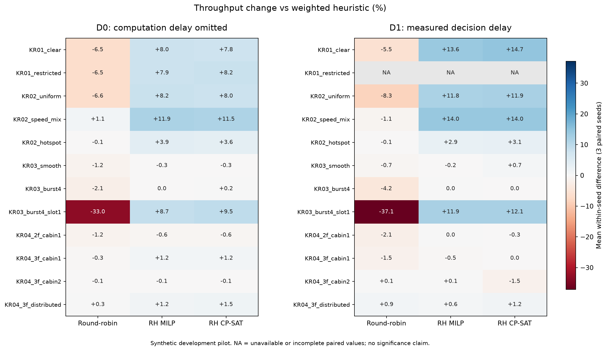

# 한국 사례 합성 파일럿 결과와 남은 보완 — 2026-11-18

**고정 코드 `b18ecb1`에서 D0 144회와 D1 144회, 총288회 기록·검수가 끝났다. 정상276회, FAILED12회다.** 실패는 D1의 통로 폭 변경 조건에4정책×3seed로 집중됐다. 이 문서는 조건당3seed의 합성 개발 파일럿 기술통계다. 기존4,020회 본 실험과 합치거나 실제 현장의 개선율·확인 실험 우세로 해석하지 않는다.

쉽게 말하면, 공동 계획은 로봇 속도 혼합·충전 부족에서 처리량을 높였고, 주문 급증에서는 같은 양을 더 제때 끝내는 데 도움이 됐다. 고른 수요와 다층 조건에서는 처리량 이점이 작았다. 기본 optimized·가중치·목적·시간 예산은 유지한다. 응용프로그램 코드는 결과 정리 중 변경하지 않았다.

## 1. 실험과 분모

- 12조건×3외부 수요seed×4정책×2시간모드=288회. 첫4회도 각144회에 포함하며 자동 재실행0회다.
- 정책: baseline / optimized / rh_milp_grid / rh_cpsat_linear. 두 RH는 같은 grid 모델, horizon40초·step2초·후보8개·공통 결정2초다. CP-SAT native는 평가에 포함하지 않는다.
- 각35분, warmup5분, 측정30분. 처리량은 측정창 완료 수/30분, 납기는 입력 deadline이 측정창에 들어오는 공통 UID 집단이다. 대기P95에서 미시작 작업은 검열되므로 미시작·미완료도 별도 보존한다.
- D0는 계산지연을 공장시간에 넣지 않는다. D1은 실측 비용과 publication 예납0.2초를 반영한다. D0/D1은 제어 경로 차이도 있는 운영 모드 비교이며 실제 공장 통신 지연 측정은 아니다.
- D0:144/144 SUCCESS. D1:132 SUCCESS+12 FAILED. 모든 실패의 원래 분모·기록을 보존했고 성공할 때까지 재실행하지 않았다.
- 실행2026-11-18 14:24~18:41 KST, 약4시간17분. 결과 압축/검수 시간과 결정 지연을 구분한다.

## 2. D1 처리량 전체 결과

단위 건/분, 정상3seed 평균이다. 상대차는 각 seed의 RH/optimized 상대차를 구한 뒤 평균했다. 실패 조건을0% 개선이나0처리량으로 바꾸지 않는다.

| 조건 | 휴리스틱 | RH MILP | RH CP-SAT | MILP 상대차 | CP 상대차 |
| --- | --- | --- | --- | --- | --- |
| KR01_clear | 4.22 | 4.80 | 4.84 | 13.6% | 14.7% |
| KR01_restricted | 보류(0/3) | 보류(0/3) | 보류(0/3) | 보류 | 보류 |
| KR02_uniform | 8.39 | 9.38 | 9.39 | 11.8% | 11.9% |
| KR02_speed_mix | 8.19 | 9.33 | 9.33 | 14.0% | 14.0% |
| KR02_hotspot | 9.04 | 9.31 | 9.33 | 2.9% | 3.1% |
| KR03_smooth | 4.80 | 4.79 | 4.83 | -0.2% | 0.7% |
| KR03_burst4 | 4.79 | 4.79 | 4.79 | 0.0% | 0.0% |
| KR03_burst4_slot1 | 4.24 | 4.76 | 4.77 | 11.9% | 12.1% |
| KR04_2f_cabin1 | 3.58 | 3.58 | 3.57 | 0.0% | -0.3% |
| KR04_3f_cabin1 | 3.56 | 3.53 | 3.56 | -0.5% | 0.0% |
| KR04_3f_cabin2 | 3.57 | 3.57 | 3.51 | 0.1% | -1.5% |
| KR04_3f_distributed | 3.53 | 3.56 | 3.58 | 0.6% | 1.2% |

## 3. 처리량과 함께 읽어야 하는 결과

| 조건·목표 | 관측된 D1 효과: 휴리스틱 대비 | 후속 판단 |
|---|---|---|
| KR01 clear | MILP 처리량+13.6%, CP+14.7%. 전체 납기 위반 약60·64pp 감소 | CP의 긴급 위반은3.8pp 증가, MILP는2.6pp 감소. 우선순위에 따라 재검증 |
| KR02 uniform/mix | 두 RH 처리량 약12~14%, 건당 에너지 약16~19% 개선 | mix에서 CP 긴급 위반+3.0pp, MILP-2.1pp. 같은 처리량도 SLA가 다름 |
| KR02 hotspot | 처리량 약3% 개선, 설비 대기 감소, RH fallback62~64% | 물리 설비 병목·제한 후보·안전 대체 규칙을 함께 분석 |
| KR03 smooth | 처리량-0.2~+0.7%, RH 긴급 위반+2.8~+7.8pp | 기본 휴리스틱 유지 후보. 추가 계산의 이득이 작음 |
| KR03 burst4 | 처리량 약0%, 전체 납기 위반20.2~23.7pp·긴급4.9~6.1pp 감소 | 완료 수는 같아도 더 제때 끝냄. 에너지/건 약18~20% 감소 |
| KR03 burst4_slot1 | 처리량+11.9~12.1%, 긴급 위반11.6~14.1pp·에너지/건 약25~26% 감소 | 유망하지만 긴급 위반은 여전히37.3%·34.8%. 현장 채택 확정 아님 |
| KR04 2/3층 | 처리량 차이-1.5~+1.2%, 일부 에너지 개선 | D0와 에너지 부호 반전, 작은 긴급 모집단, CP 한 seed의 전량 fallback 확인 |

에너지는 이동·작업 battery-unit/측정창 완료 수다. 대기·승강기 모터·설비 전력을 포함하지 않으며 Wh/원으로 바꾸지 않는다. 고른 수요에서 D0 RH 에너지는32~34% 증가했고,3층 분산 충전도 D0 증가/D1 감소로 방향이 바뀌었다. RH가 항상 에너지를 절약한다는 결론은 없다. 물리 통로·설비 대기와 계획된 기다리기는 서로 다른 지표다.

## 4. 발견된 두 가지 지원 문제

**통로 변경12회 공통 제어 오류:** `DECISION_ERROR: 통로 3: 로봇 폭 0.6m 통행 불가`. 모두2100초까지 기록됐고 고장0·물리감사OK·coverageOK였지만 제어 callback 오류90개를 기록해FAILED다. `pause_admission()`이 안전한 drain을 위해 신규 진입 용량을0으로 만든 동안, 전체 이동표 관측이 이를 기하학적 통행 불가로 오해했다. 실제 통로3 폭5.0m·로봇폭0.6m이며, 정지 전 capture 성공/정지 후 동일 예외를 microcheck로 재현했다. 임시 정지와 영구 경로 불가를 구분하는 수정·회귀가 필요하다. 이번 source를 소급 수정하지 않는다.

**CP-SAT 분산 충전의 seed2026111702:** 측정창 native 반환0회, dispatch85회 모두fallback, `BACKEND_NOT_READY`889개를 기록했다. 정상 운영 관측은 보존하되 CP-SAT이 실제로 푼 성능처럼 표현하지 않는다. 이 조건의 호출 비용 표본은 나머지2seed에 조건부다. 모든 RH 수치는 대체 규칙까지 포함한 운영 정책 성능이다.

## 5. 시간·물리·재현 검수

| 검수 | 결과 | 해석 범위 |
|---|---|---|
| 계획/저장 무결성 | 중복·누락 없이288회.14,163개 압축 파일 hash/크기 대조 PASS | 원본과 분석 자료 일치 |
| 전체 원시 재구성 | 저장 이벤트/모집단/메트릭 재구성·loader 검수 | 정상276회와 실패12회 보존 |
| 물리·에너지 | 전체288회 고장/물리감사실패/구조에너지0. 최대 보존오차 약1.7e-13unit | 실제 현장 충돌 회피 인증 아님 |
| D1 publication coverage |144회 모두 위반0 | 이전216회 실패나 대규모 지원 문제 해결을 일반화하지 않음 |
| D1 dispatch 2초 초과 | 정상132회에서 MILP 2/5451, CP 1/5509. RR/휴리스틱0 | P95<2초가 모든 결정의 기한 보장은 아님 |
| D1 auxiliary 2초 초과 | MILP 3/52855, CP 0/52689. 모든 정책 늦은 수락0 | 보조 요청과 배정을 분리 |
| 저장 결정 재생 | 고정 최초 입력 D0/D1×두 RH 4/4 digest 일치 | solver 재풀이·새 독립 표본·전288회 재생 아님 |
| 보고서 독립 대조 | paired scalar460개·처리량 표144칸·42표 구조/링크 검수 PASS | 파일럿 기술통계의 보고 정확성 |

원본 commit `b18ecb14a0b65405a58a87cac2bd35b7b2ecaef9`, 188개Python source `0f735f9e688fde917db590b25b049c743c17d2490fa68016102bdb54e8645944`, 입력 manifest `b29978ced3ea8135fab39105a14c40a70a489696cd2cab2a9c5836f64b9bffa9`다. Python3.11.14/macOS arm64, OR-Tools9.15.6755를 사용했다. 결과 문서 커밋은 실행 코드 커밋과 구분한다.

전체 집계·3seed paired 차이·분모·실패 진단·감사/재생 영수증은 [기계 근거](scenarios/korean_cases_20261117/evidence/results_20261118.json)에 보존한다. 전체 Markdown/HTML 보고서와8개PNG/SVG·개별arm·원시결과는 실행 workspace의 `outputs/CLOVER_KOREAN_REPORT_20261118`, `outputs/CLOVER_KOREAN_EXECUTION_20261118`에 별도 보존했다. ZIP 공유본은 원시 대용량 이벤트 전체를 포함하지 않는다.

## 6. PRD 상태와 다음 작업

완료: 한국 사례12조건의 두 시간 모드 실행·전체 원시 검수·실패 원인 분리·탐색적 전체 보고서. 미완료: 공통 제어 수정·backend 준비 상태 지원 검수·높은 fallback의 원인 분리·독립 확인 실험·R7 환경별 최종 선택.

다음 순서는 통로 일시정지/capture 수정과 D1 회귀 → backend 미준비 재현/지원 검사 → 부하 곡선·독립 지도·충전전력/슬롯 분리·납기/SOC 민감도 → 충분한 반복 충전/회복 관측 → 새 seed/지도·가설/분석 등록 후 확인 실험이다. 3seed 파일럿의 좋은 조건을 골라 같은 자료로 최종 추천 정확도까지 평가하지 않는다.

KR01의 제한 요청 구간900~1200초를 D0에서5분별로 재집계하면 휴리스틱 처리량은 clear보다0.40건/분 낮고 통로 대기는77.1robot-second 높았다. 이후 회복으로30분 평균 차이가 작아졌다. KR04는 총면적4800→7200m²·거리/배치도 함께 변하므로 순수 층수 효과로 해석하지 않는다. 실제 업체에 해당 합성 긴급/충전 문제가 있었다는 뜻도 아니다.
