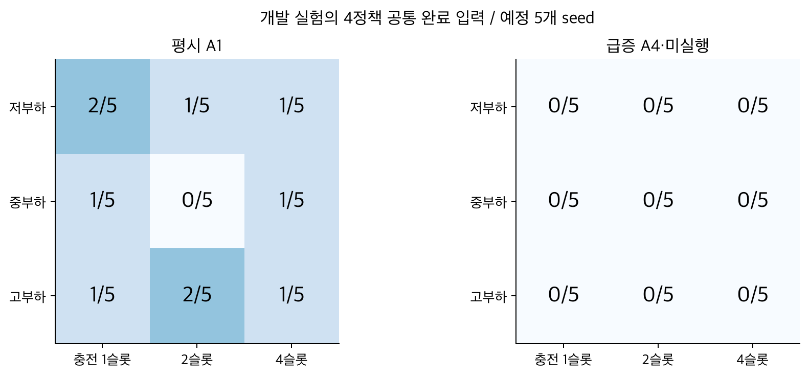
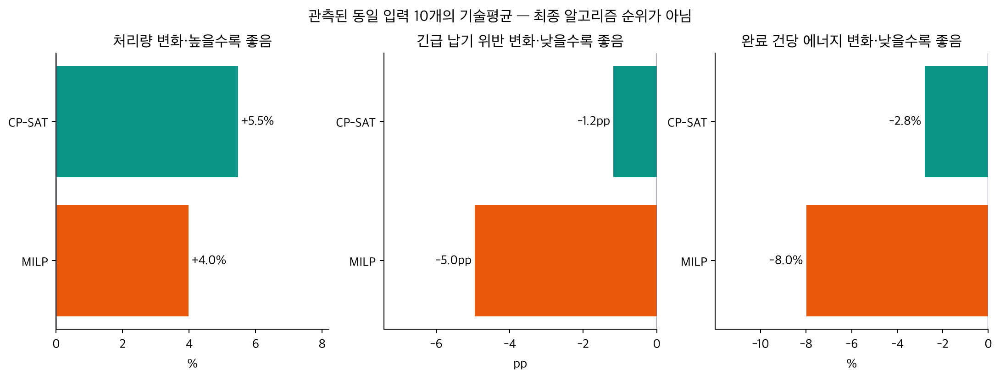
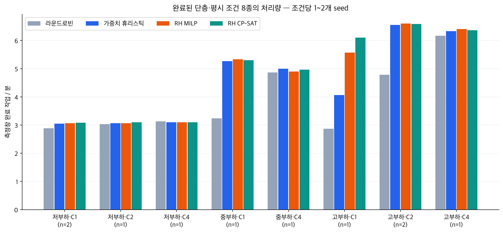
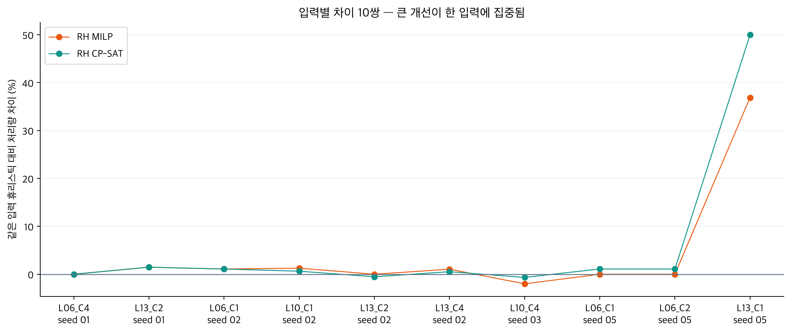

# CLOVER 시뮬레이션 결과 종합 보고서

작성일: **2026-11-21, 한국 시간**. 범위: **중단 시점까지 확보된 자료의 전체 검수와 탐색적 결과**.

> 이 보고서는 재개 전 중단 시점의 62개 결과를 고정해 정리한 이력이다. 전체 620회의 결과는 [완료 보고서](STATIC_SCENARIO_RESULTS_20261125.md)에 있다. 아래 집계와 공유 ZIP은 당시 자료를 보존한다.

**전체 실험은 완료되지 않았다.** 계획 620회 중 저장 체크포인트까지 완료한 결과는 61회이고, 실행은 SUCCESS지만 압축·체크포인트가 끝나지 않은 원시 결과가 1회 더 있다. 나머지 558회는 결과가 없다. 실제 실행 프로세스가 없는 것을 확인해 상태를 `STOPPED_INTERRUPTED`로 바로잡았다. 전체 시나리오의 최종 알고리즘 선택은 보류한다.

현재 자료에서 말할 수 있는 핵심은 다음과 같다.

- 네 정책이 모두 완료한 동일 입력 10개·40회에서, 휴리스틱 대비 처리량의 입력별 상대차 평균은 **MILP +4.0%, CP-SAT +5.5%**였다.
- 같은 자료에서 MILP는 긴급 납기 위반과 완료 건당 에너지의 평균 감소 폭이 더 컸고, CP-SAT은 처리량 평균이 더 높았다. 목표에 따라 판단이 달라진다.
- **평균 처리량 개선은 고부하·충전 1슬롯의 한 입력에 크게 좌우됐다.** 이 입력을 제외한 나머지 9개의 평균 상대차는 MILP +0.3%, CP-SAT +0.5%다. 원자료는 10개 모두 유지했다.
- 주 비교 자료는 단층·평시 도착의 8조건뿐이며 조건당 seed는 1~2개다. 급증 개발 실험과 새 지도 3종 검증은 아직 실행하지 않았다. 독립 확인 실험도 등록 전이다.

## 1. 실제 완료 범위와 중단 상태

| 단계 | 계획 | 저장 완료 SUCCESS | 원시 SUCCESS·저장 미완료 | 미기록/미실행 |
| --- | --- | --- | --- | --- |
| M1 D1 기술검사 | 12 | 12 | 0 | 0 |
| M1 D0 기술검사 | 8 | 8 | 0 | 0 |
| M2a 평시 개발 | 180 | 41 | 1 | 138 |
| M2b 급증 개발 | 180 | 0 | 0 | 180 |
| M3 새 지도 검증 | 240 | 0 | 0 | 240 |
| 합계 | 620 | 61 | 1 | 558 |

결과 파일 기준 62/620=10.0%, 체크포인트 완료 기준 61/620=9.8%다. 새 수요를 62개 독립 생성했다는 뜻은 아니다. 한 입력에 4정책을 적용하며 M1에는 같은 기술 입력의 D0/D1도 포함된다.

중단된 것은 `job_033 / ADV_L06_C2_A1 / seed2026111904`다. 휴리스틱 결과는 저장 완료, MILP는 원시 SUCCESS 파일과 이벤트가 있고 `.xz.pending`에서 저장이 중단돼 있었다. baseline과 CP-SAT의 결과는 없다. 이 배치의 2개 결과도 검수했지만, 네 정책을 함께 비교하는 주 분석에서는 별도 부록으로 분리했다.

2026-11-21 확인 시 driver PID48472와 해당 경로의 잔여 실행 프로세스가 없었다. 마지막 부분 압축파일 수정 시각은 **2026-11-20 20:06:08 KST**다. 정확한 프로세스 종료 시각·원인은 기록되지 않아 알 수 없다. 메모리 부족·절전·알고리즘 오류라고 단정하지 않는다. 보고서 작성 전 남아 있던 `RUNNING` 표시는 실제 상태를 반영하지 못했다.

원래 상태 파일은 로컬 보고서의 `source_state/`에 저장했고, 원시 결과·이벤트·부분 압축파일은 수정하지 않았다. 알고리즘 FAILED 결과는 0건이지만 **운영 배치 중단은 1건**이다. 따라서 전체 캠페인이 성공했다고 표현할 수 없다. [중단 상태 정정 근거](scenarios/static_study_20261120/evidence/results_20261121/interruption_review.json)를 함께 보존한다.

## 2. 어떤 공장과 알고리즘을 비교했나

### 2.1 공장과 입력

이번 개발용 지도는 **단층 60×40m, 로봇 8대, 작업 설비 6개, 충전소 1곳**이다. 예전에 보여준 3층 사례와 별도다. 이동은 고정 노드·통로 그래프이며 실제 레일·공장 벽·충돌 회피 제어기를 그대로 재현한 모델은 아니다. 이번 개발 지도 통로 폭은 5m이며, 좁은 통로의 새 지도 검증은 아직 실행하지 않았다.

| 변수 | 설정 | 뜻 |
| --- | --- | --- |
| 도착 부하 L06/L10/L13 | 0.048 / 0.080 / 0.104 건/s | 평균 2.88 / 4.80 / 6.24 건/분의 입력 가정 |
| 충전 슬롯 C1/C2/C4 | 1 / 2 / 4 | 동시에 충전 가능한 수 |
| 슬롯당 충전속도 | 0.25 battery-unit/s | 슬롯 증가 시 총 충전 용량도 함께 증가 |
| 도착 형태 A1/A4 | 평시 지수 간격 / 같은 작업 수의 burst4 | M2의 A4는 미실행 |
| 작업 처리시간 | 8초·편차 0 | 설비 한 곳의 inspection 작업 1건 |
| 로봇 속도·배터리 | 1.05m/s · 60unit | 8대 동일 사양 |
| 초기 SOC | 60~80%에서 고정 생성 | 정책 간 동일 초기 목록 |
| 이동·작업 소모 | 0.1unit/m · 0.1unit/s | Wh·전기요금으로 환산하지 않음 |
| 긴급 비중·납기 여유 | 15% · 일반 120초/긴급 45초 | 완료 결과가 아니라 입력으로 정함 |
| 실행·측정 | 총 2100초·워밍업 300초 | 측정창 1800초=30분 |
| 경로 후보 | K=1 | 여러 경로 중 최적 경로를 고르는 실험이 아님 |

λ_ref=0.08은 합성 입력의 기준값이다. 측정한 공장 처리 용량이나 이용률ρ=1을 뜻하지 않는다. 처리량 단위는 작업 건/분이다. 이 입력의 한 작업을 실제 완제품 한 개의 전체 생산 완료와 같다고 해석하지 않는다.

### 2.2 정책 네 종류

| 정책 | 쉽게 설명하면 | 이번 평가에서의 역할 |
| --- | --- | --- |
| baseline | 로봇에게 정해진 차례로 작업을 나눔 | 단순 비교 기준 |
| optimized | 거리·배터리·대기·납기 점수로 현재 유리한 배정을 고름 | 기본 정책·주 비교 기준 |
| RH MILP | 여러 로봇의 가까운 미래 시간표를 정수식으로 함께 풂 | 공유 자원·충전·작업을 공동 계획 |
| RH CP-SAT | 같은 시간표 문제를 정수·논리 탐색으로 풂 | 같은 공통 grid 모델의 다른 solver |

두 RH는 horizon 40초, 간격 2초, 후보 작업 최대 8개, 기본 재계획 간격 5초를 사용한다. 첫 계획 부분만 적용하고 다시 계획하는 rolling horizon이다. 실제 상태가 달라지면 반영 전에 다시 확인하며 필요하면 휴리스틱 fallback을 사용한다. CP-SAT interval/native 표현은 이번 비교 대상이 아니다.

기본 optimized 정책·가중치·목적함수·공통 결정 예산은 바꾸지 않았다. D1은 계산·반영 지연을 공장시간에 반영한다. 결정 soft deadline은 2초이고 publication allowance 0.2초를 포함한 기존 계약을 유지했다. 설정 파일의 수학 timing_mode=D0은 staged D1의 공통 수학 설정이며, D1 제어는 별도 decision settings로 켠다.

## 3. 비교 방법과 숫자를 읽는 법

주 비교 집합은 **4정책 모두 결과가 있는 개발 입력 10개**다. 동일한 지도·조건·수요 seed·trace·초기 SOC·납기를 사용했으며 입력 hash도 일치했다. 각 조건에 계획했던 5 seed 중 실제로는 1~2 seed만 갖고 있다. 조건당 1 seed짜리 차이를 재현된 일반 법칙처럼 해석하지 않는다.

M1 기술검사 20회는 운영·solver 사용·재생을 확인하는 자료이고 주 성능 평균에 넣지 않았다. job033의 2개 결과도 부록에 공개하되 네 정책 공통 평균에는 넣지 않았다. 미실행 558건을 처리량 0이나 차이 0으로 채우지 않았다. 실행 순서를 섞었더라도 중단으로 관측 조건이 불균형해졌으므로 결측이 무작위라고 가정하지 않는다.

- **처리량:** 측정 30분 동안 끝난 작업 수/30. 높을수록 좋다.
- **납기 위반:** 입력 납기가 측정창 안에 있는 공통 작업 중, 납기까지 끝나지 않은 비율. 미완료도 포함한다. 긴급은 priority0만 따로 본다. 주 비교 입력의 납기 모집단은 정책당 1473건, 그중긴급 215건이다.
- **에너지/건:** 측정창 소비 battery-unit/완료 수. 낮을수록 좋다. 설비·건물·승강기 전체 전력이나 원가가 아니다.
- **대기:** 출발한 작업의 P95와 아직 출발하지 못한 개수를 함께 본다. 미출발은 P95 계산에 직접 들어가지 않는다.
- **변화율:** 각 입력에서 `(RH−휴리스틱)/휴리스틱×100`을 계산하고 10개를 평균한다. 납기 비율 차이는 pp(퍼센트포인트)다. 10%→8%는−2pp다.

아래 정책 평균은 10개 입력에 같은 가중치를 준 기술평균이다. 서로 다른 부하의 작업 수를 가중해 공장 전체 개선율을 추정한 값이 아니다. p-value·신뢰구간·통계적 유의성은 산출하지 않는다.

## 4. 같은 입력 10개의 전체 결과

| 정책 | 처리량(건/분) | 전체 납기 위반 | 긴급 납기 위반 | 에너지(unit/건) | 종료 미완료(평균건) |
| --- | --- | --- | --- | --- | --- |
| 라운드로빈 | 3.86 | 47.70% | 82.68% | 4.708 | 33.1 |
| 가중치 휴리스틱 | 4.60 | 10.55% | 28.87% | 2.896 | 9.9 |
| RH MILP | 4.77 | 8.48% | 23.92% | 2.618 | 5.0 |
| RH CP-SAT | 4.83 | 8.91% | 27.69% | 2.746 | 3.3 |

| 휴리스틱 대비 | 처리량 상대차 평균 | 전체 납기 차이 | 긴급 납기 차이 | 에너지/건 상대차 | 처리량 우세/동률/열세 입력 |
| --- | --- | --- | --- | --- | --- |
| RH MILP | +4.0% | -2.1pp | -5.0pp | -8.0% | 5/4/1 |
| RH CP-SAT | +5.5% | -1.6pp | -1.2pp | -2.8% | 7/1/2 |

처리량 상대차의 중앙값은 MILP +0.5%, CP-SAT +0.9%다. 범위는 각각-2.0%~+36.9%, -0.7%~+50.0%였다. 평균과 중앙값의 차이가 크므로 일부 큰 개선 입력을 함께 확인해야 한다.

## 5. 어떤 조건에서 차이가 났나

### 5.1 조건별 처리량

단위 건/분. n은 네 정책이 모두 완료된 독립 수요 seed 수다. C는 충전 슬롯, A1은 평시 도착이다.

| 조건 | n | 라운드로빈 | 휴리스틱 | MILP | CP-SAT | MILP 상대차 | CP 상대차 |
| --- | --- | --- | --- | --- | --- | --- | --- |
| L06_C1_A1 | 2 | 2.88 | 3.05 | 3.07 | 3.08 | +0.5% | +1.1% |
| L06_C2_A1 | 1 | 3.03 | 3.07 | 3.07 | 3.10 | +0.0% | +1.1% |
| L06_C4_A1 | 1 | 3.13 | 3.10 | 3.10 | 3.10 | +0.0% | +0.0% |
| L10_C1_A1 | 1 | 3.23 | 5.27 | 5.33 | 5.30 | +1.3% | +0.6% |
| L10_C4_A1 | 1 | 4.87 | 5.00 | 4.90 | 4.97 | -2.0% | -0.7% |
| L13_C1_A1 | 1 | 2.87 | 4.07 | 5.57 | 6.10 | +36.9% | +50.0% |
| L13_C2_A1 | 2 | 4.78 | 6.55 | 6.60 | 6.58 | +0.7% | +0.5% |
| L13_C4_A1 | 1 | 6.17 | 6.33 | 6.40 | 6.37 | +1.1% | +0.5% |

### 5.2 가장 유망했던 조건: 고부하·충전 1슬롯

`ADV_L13_C1_A1 / seed2026111905` 한 입력에서 휴리스틱 4.07건/분, MILP5.57건/분, CP-SAT6.10건/분이었다. 처리량 차이는 각각+36.9%, +50.0%다. 에너지/건은 26.3%,34.5% 감소했고 긴급 납기 위반은 두 RH 모두 17.4pp 감소했다.

공유 충전 자원이 부족한 상태에서 작업과 충전을 함께 계획하는 방식이 유망하다는 관측이다. **한 개 seed이므로 같은 조건의 반복 검증이 필요하다.** 다른 슬롯 조건은 확보한 seed 구성이 다르므로 이 표만으로 충전 슬롯의 순수 효과를 확정하지 않는다. 같은 seed의 슬롯 대조와 자원 대기 노출을 함께 검증해야 한다.

이 한 입력의 큰 개선이 전체 10개 평균을 끌어올렸다. 원자료를 모두 공개한 상태에서 영향도를 확인하면, 나머지 9개의 처리량 상대차 평균은 MILP +0.3%, CP-SAT +0.5%였다. 따라서 “대부분 환경에서 처리량이 4~5% 개선된다”는 결론은 현재 자료가 뒷받침하지 않는다.

### 5.3 처리량만으로 선택하면 놓치는 결과

| 조건·표본 | 관측된 차이 | 해석 |
| --- | --- | --- |
| L06_C4_A1 · n1 | 처리량은 같음. 에너지 MILP+4.2%, CP+6.0% | 여유 환경에서는 추가 계획 비용의 이득이 작거나 에너지가 늘 수 있음 |
| L06_C2_A1 · n1 | MILP 처리량 동일, CP+1.1%. 긴급 위반은 둘 다+15.4pp | 작은 처리량 이점이 긴급 서비스 개선을 뜻하지 않음 |
| L10_C1_A1 · n1 | 처리량 MILP+1.3%, CP+0.6%. 에너지는+20.5%, +36.7% | 처리량이 조금 늘어도 건당 에너지와 긴급 납기가 나빠질 수 있음 |
| L10_C4_A1 · n1 | 처리량 MILP−2.0%, CP−0.7%. 에너지와 긴급 위반은 감소 | 처리량·납기·에너지 사이에 교환관계가 있음 |
| L13_C2_A1 · n2 | 처리량은+0.7%/+0.5%. 긴급 위반 MILP−20.2pp, CP+2.7pp | 비슷한 완료 수에서도 긴급 작업의 결과가 달라짐 |

긴급 작업 수가 적으면 몇 건 차이도 큰 pp로 나타난다. 관측된 큰 차이를 유지하되 충분한 반복이 되기 전에는 일반화하지 않는다. 로봇이 더 빨리 처리하는 것, 더 제때 끝내는 것, 더 적은 에너지를 쓰는 것은 별개 목표다.

## 6. 대기와 계산 비용

### 6.1 아직 기다리는 작업을 포함해서 보기

| 정책 | 입력별 시작 대기 P95의 중앙값(초) | 미시작 작업 합계 | 종료 미완료 평균 |
| --- | --- | --- | --- |
| 라운드로빈 | 298.9 | 327 | 33.1 |
| 가중치 휴리스틱 | 44.5 | 91 | 9.9 |
| RH MILP | 46.7 | 46 | 5.0 |
| RH CP-SAT | 52.2 | 29 | 3.3 |

P95 열은 10개 실행의 P95를 구한 뒤 그 중앙값을 적은 것이다. 전체 작업을 합친 P95가 아니다. 미시작 열은 측정창에 도착하고 끝까지 출발하지 못한 작업의 합계다. 아직 출발하지 못한 작업은 P95에서 빠지므로, P95가 작아도 긴 대기가 적다고 단정할 수 없다. 예를 들어 RH의 대기 P95 중앙값은 휴리스틱보다 조금 크지만 미시작 개수와 종료 미완료는 더 적었다.

### 6.2 공유 자원 대기와 긴 대기

| 정책 | 충전 대기(로봇·초/실행) | 설비 대기(로봇·초/실행) | 통로 대기(로봇·초/실행) | 일반 작업 미시작 120초 초과 합계 | 일반 작업 출발대기 120초 초과 합계 |
| --- | --- | --- | --- | --- | --- |
| 라운드로빈 | 3351.7 | 47.0 | 0.0 | 233 | 402 |
| 가중치 휴리스틱 | 795.4 | 60.4 | 0.0 | 72 | 60 |
| RH MILP | 905.5 | 46.1 | 0.0 | 27 | 73 |
| RH CP-SAT | 1440.2 | 38.8 | 0.0 | 11 | 80 |

로봇 2대가 각각 10초 기다리면 20로봇·초다. 자원 대기는 측정창과 겹치는 구간을 합쳐 실행당 평균을 냈다. 미시작·출발대기 개수는 해당 작업 도착 집단의 10개 입력 합계다.

충전 대기는 RH가 휴리스틱보다 길었다. 처리량과 작업 미완료가 개선됐다고 모든 공유 자원의 대기가 줄었다고 말할 수 없다. 자원 앞에서의 명시적 대기와 계획표에 따른 대기는 집계 범위가 다르다. 이번 넓은 통로 지도에서는 명시적 통로·교차점 대기가 0이어서, 좁은 통로 병목을 해결했다는 근거도 아직 없다. 이를 평가하려면 M3의 새 지도가 필요하다.

120초 초과는 긴 대기의 기준이다. 코드에 교착 검출기가 없으므로 이 개수를 교착 건수라고 부르지 않는다. 아직 출발하지 못한 일반 작업의 긴 대기는 RH에서 줄었지만, 출발한 작업만 보면 긴 대기 표본이 더 많을 수도 있다. 미완료 작업이 빠진 통계의 한계를 함께 봐야 한다.

### 6.3 결정 지연과 fallback

| 정책 | 기한 평가대상 dispatch | 기한 초과 | 늦은 수락 | 결정 지연 P95(초) | fallback |
| --- | --- | --- | --- | --- | --- |
| 라운드로빈 | 1163 | 0 | 0 | 0.436 | 2/1163 (0.2%) |
| 가중치 휴리스틱 | 1350 | 0 | 0 | 0.427 | 8/1350 (0.6%) |
| RH MILP | 1433 | 0 | 0 | 0.677 | 348/1433 (24.3%) |
| RH CP-SAT | 1467 | 0 | 0 | 0.676 | 355/1467 (24.2%) |

주 비교 40회에서 완전한 2초 기한이 관측창 안에 들어오는 dispatch를 기준으로 계산했다. 창 끝의 기한이 아직 끝나지 않은 결정은 별도로 검열했다. 지연 P95는 그 대상에서 종료된 결정의 지연 표본을 합쳐 계산했다. 작업 대기 P95와 다른 지표다. 이 관측에서 기한 초과가 0이어도 모든 환경의 2초 하드 보장은 아니다. 보조 충전 요청의 시간 통계와 각 단계별 빌드·풀이·검증 시간은 [전체 기계 근거](scenarios/static_study_20261120/evidence/results_20261121/results_20261121.json)의 개별 arm에 남겼다.

| RH 정책 | worker 계산 시도 | 해 반환 | native search 증거 | 실제 primary prefix 반영 | 반환 보고서의 최대 worker RSS |
| --- | --- | --- | --- | --- | --- |
| RH MILP | 1389 | 1389 | 1389 | 1041 | 116.7MiB |
| RH CP-SAT | 1424 | 1424 | 1424 | 1069 | 132.0MiB |

위 호출·반환·반영은 측정창 안의 trigger를 기준으로 센 횟수다. 앞의 deadline 평가 집단과 분모가 조금 다르므로 열끼리 임의로 비율을 만들지 않는다. prefix 반영은 작업 완료 수가 아니다. RSS는 반환 보고서에 있는 worker 값이며 실험 프로그램 전체의 메모리 사용량이 아니다.

두 RH의 fallback은 약 24%였다. 주된 사유는 40초 계획에서 작업을 모두 보류한 `ALL_DEFERRED_RECOVERY`와 상태가 바뀐 stale 거절이다. 따라서 이 결과는 **RH 계획과 안전 fallback을 합친 운영 정책**의 성능이다. 순수 solver만으로 모든 결정을 처리한 결과라고 표현하지 않는다.

## 7. 검수 결과

| 검사 | 결과 | 범위 |
| --- | --- | --- |
| 입력·소스·정책·초기상태·납기 hash | PASS | 62개 결과 파일·공통 입력 비교 |
| 압축 완료 보관 파일의 저장/논리 hash·크기 | 4,241개 PASS | 부분 .pending 파일은 정상 archive로 취급하지 않음 |
| 원시 이벤트 순서·digest·물리 digest·자원 대기 재구성 | 62/62 PASS | traffic grant의 점유≤용량 확인 |
| 작업 UID·상태 수·완료·처리량·에너지 재계산 | 62/62 PASS | 미실행 작업을 0으로 대체하지 않음 |
| 고정 지도·최종 물리 감사·고장·구조 에너지 | 고정/감사 PASS, 고장·rescue 0 | 이번에 확보된 결과에 한함 |
| 최대 에너지 보존 오차 | 9.24e-14 battery-unit | Wh·원가나 실제 공장 충돌 회피 인증이 아님 |
| 반영 거절된 resource-capacity 계획 | 6개 원래 snapshot 독립검증 오류 0 | 반영 전 새 자원 달력에서 거절된 사유 보존 |
| 기존 M1 저장 결정 재생 | 네 정책 4/4 일치 | 이번에 62개 전체를 새로 재실행한 것은 아님 |

주 비교 집합의 자원 용량 관련 거절은 MILP 2건·CP-SAT 2건이다. M1의 2건까지 합쳐 6개를 검토했으며, 원래 snapshot의 반환 계획은 모두 검증을 통과했다. 갱신된 달력에서 거절된 결정을 반영하지 않고 fallback을 사용한 기록을 유지했다. [거절계획검토](scenarios/static_study_20261120/evidence/results_20261121/rejected_plan_review.json)에 token과 원래 보고서 상태를 남겼다.

이번 보고서 작성에서는 새로운 native solver 실행이나 시뮬레이션 재시도를 하지 않았다. 원시 이벤트 재구성·입력 검수와 새로운 독립 시뮬레이션 표본은 구분한다. 기존 M1 재생 근거와 CI 근거는 당시 영수증이다. 이번에 모든 실행을 새로 재생한 것은 아니다.

## 8. 지금 선택할 수 있는 범위

| 환경·목표 | 현재 판단 | 추가로 필요한 근거 |
| --- | --- | --- |
| 여유로운 단층·평시 수요 | 기본 휴리스틱 유지 후보 | RH의 작은 처리량 차이가 계산·납기·에너지 비용을 상쇄하는지 반복 검증 |
| 고부하·충전 1슬롯 | MILP와 CP-SAT을 우선 확인할 유망 조건 | 현재 n=1. 동일 조건의 추가 seed·같은 seed의 슬롯 대조·자원 대기 검증 |
| 긴급 납기·에너지 우선 | 관측된 10개 입력 평균에서는 MILP가 더 유망 | 저부하에서 긴급 위반이 늘어난 반례도 있어 절대 SLA 검증 필요 |
| 처리량 우선 | 고부하 C1에서는 CP-SAT이 더 높았음 | 한 입력의 개선 집중·다른 조건의 에너지 증가 확인 |
| 급증·좁은 통로·우회 연결·설비 집중 지도 | 개발/지도 검증 결론 보류 | M2b·M3 미실행 |
| 2층·3층·운영 중 통로 변경 | 이번 캠페인으로 판단할 자료 없음 | 별도 다층·동적 변경 검증. 기존 실패 이력 보존 |

**기본 정책을 바꿀 근거는 아직 충분하지 않다.** 현재 optimized를 유지하고, 자원 경쟁이 심한 조건에서 두 RH의 확인 실험을 우선하는 것이 타당하다. 이 표는 추가 검증의 우선순위다. 현장 배포용 자동 선택 규칙으로 사용하기에는 근거가 부족하다. RH에서도 평균 긴급 납기 위반이 23.9%와 27.7% 남아 있으므로, 처리량 개선과 운영 납기 목표의 충족을 구분해야 한다. 합성 긴급 납기 45초의 물리적 실현 가능성도 후속으로 점검할 필요가 있다.

## 9. 남은 작업과 PRD 기준 상태

| 구분 | 상태 | 완료 기준 |
| --- | --- | --- |
| M0 공통 모델·고정지도·실행 입력 검수 | 이번 범위 구현·검수 완료 | 동적 변경 오류 수정은 별도 |
| M1 기술검사·G1 | 20/20·PASS | 네 정책 재생·native 실제 반영·충전/납기 노출 |
| M2a 평시 개발 180회 | 41 저장 완료 + 1 원시 완료, 배치 중단 | 중단 배치 복구 규칙과 남은 138회 결과 필요 |
| M2b 급증 개발 180회 | 미실행 | 같은 입력·예산·소스의 4정책 비교 |
| M3 지도검증 240회 | 미실행 | 새 지도 3개·조건 4개·새 seed 5개·정책 4종 |
| M4 독립 확인·환경별 최종 선택 | 미등록/미완료 | 표본수·새 지도/seed·가설·선택 기준 사전 등록 |

다음 순서는 ① 실제 PID/heartbeat와 종료 상태를 함께 보는 실행 관리 보완 → ② job033의 원시 MILP 결과 압축 복구와 미실행 2정책의 처리 규칙 확정 → ③ 나머지 558개 미기록 arm 진행 → ④ M2/M3의 전체 분모 보고 → ⑤ 독립 확인 실험 등록이다. 압축이 중단됐다는 이유로 이미 완료한 solver를 성공할 때까지 다시 돌리지 않는다. 소스나 설정이 바뀌면 새 캠페인으로 분리하고 기존 결과를 보존한다.

향후 표본수는 관측된 paired 차이의 변동·목표 정밀도·실용 차이에 따라 정해야 한다. 조건당 seed 5개도 탐색 단계이며 현재의 1~2개로 유의성을 선언할 수 없다. 기존 분석기의 최소 10쌍/지도·최소 3지도 게이트를 낮추지 않는다. 다른 조건의 10개 입력을 하나의 동질적 표본처럼 취급하지 않는다.

## 10. 발표·공유용 설명

> “단층 합성 공장에서 라운드로빈, 가중치 휴리스틱, rolling horizon MILP와 CP-SAT을 비교했습니다. 기술 검사 20회는 통과했고, 개발 실험은 중단되어 네 정책이 모두 끝난 10개 입력으로 우선 분석했습니다. 휴리스틱 대비 입력별 처리량 상대차는 MILP 평균 +4.0%, CP-SAT 평균 +5.5%였지만, 큰 개선은 고부하·충전 1슬롯의 한 입력에 집중됐습니다. MILP는 평균적으로 납기와 에너지의 개선 폭이 더 컸습니다. 급증 조건과 새 지도 검증은 미완료여서 최종 우승 알고리즘이나 실제 공장 개선율은 아직 확정하지 않았습니다.”

## 부록 A. 네 정책 공통 완료 입력 10개

| job | 조건 | seed | 휴리스틱 | MILP | CP-SAT | MILP 차이 | CP 차이 |
| --- | --- | --- | --- | --- | --- | --- | --- |
| 7 | L06_C4_A1 | 2026111901 | 3.10 | 3.10 | 3.10 | +0.0% | +0.0% |
| 12 | L13_C2_A1 | 2026111901 | 6.80 | 6.90 | 6.90 | +1.5% | +1.5% |
| 14 | L06_C1_A1 | 2026111902 | 3.07 | 3.10 | 3.10 | +1.1% | +1.1% |
| 17 | L10_C1_A1 | 2026111902 | 5.27 | 5.33 | 5.30 | +1.3% | +0.6% |
| 21 | L13_C2_A1 | 2026111902 | 6.30 | 6.30 | 6.27 | +0.0% | -0.5% |
| 22 | L13_C4_A1 | 2026111902 | 6.33 | 6.40 | 6.37 | +1.1% | +0.5% |
| 28 | L10_C4_A1 | 2026111903 | 5.00 | 4.90 | 4.97 | -2.0% | -0.7% |
| 41 | L06_C1_A1 | 2026111905 | 3.03 | 3.03 | 3.07 | +0.0% | +1.1% |
| 42 | L06_C2_A1 | 2026111905 | 3.07 | 3.07 | 3.10 | +0.0% | +1.1% |
| 47 | L13_C1_A1 | 2026111905 | 4.07 | 5.57 | 6.10 | +36.9% | +50.0% |

단위 건/분. 표의 10개가 주 분석 집합이다. 평균의 분모를 확인할 수 있도록 작은 차이와 음수 차이도 포함했다.

## 부록 B. M1 기술검사 20회

아래 수치는 각 조건의 기술 seed 2026111900 결과다. 주 성능 평균에 합치지 않는다. D0/D1은 계산 지연뿐 아니라 제어 경로도 다르므로, 그 차이 전체를 solver 속도의 인과효과로 해석하지 않는다.

| 모드 | 조건 | 정책 | 처리량 | 전체 납기 위반 | 긴급 납기 위반 | 에너지/건 |
| --- | --- | --- | --- | --- | --- | --- |
| D1 | L06_C4_A1 | 라운드로빈 | 2.27 | 5.97% | 40.00% | 4.803 |
| D1 | L06_C4_A1 | 가중치 휴리스틱 | 2.30 | 0.00% | 0.00% | 2.177 |
| D1 | L06_C4_A1 | RH MILP | 2.30 | 0.00% | 0.00% | 2.387 |
| D1 | L06_C4_A1 | RH CP-SAT | 2.27 | 0.00% | 0.00% | 2.435 |
| D1 | L10_C2_A4 | 라운드로빈 | 4.27 | 58.45% | 100.00% | 4.916 |
| D1 | L10_C2_A4 | 가중치 휴리스틱 | 4.57 | 16.20% | 63.16% | 3.810 |
| D1 | L10_C2_A4 | RH MILP | 4.57 | 7.04% | 36.84% | 2.835 |
| D1 | L10_C2_A4 | RH CP-SAT | 4.57 | 4.93% | 36.84% | 2.649 |
| D1 | L13_C1_A4 | 라운드로빈 | 2.80 | 75.13% | 100.00% | 4.858 |
| D1 | L13_C1_A4 | 가중치 휴리스틱 | 5.00 | 47.72% | 48.28% | 3.121 |
| D1 | L13_C1_A4 | RH MILP | 5.57 | 36.55% | 48.28% | 2.509 |
| D1 | L13_C1_A4 | RH CP-SAT | 6.43 | 26.90% | 48.28% | 2.291 |
| D0 | L06_C4_A1 | 라운드로빈 | 2.30 | 10.45% | 70.00% | 4.883 |
| D0 | L06_C4_A1 | 가중치 휴리스틱 | 2.27 | 0.00% | 0.00% | 2.057 |
| D0 | L06_C4_A1 | RH MILP | 2.33 | 1.49% | 10.00% | 1.771 |
| D0 | L06_C4_A1 | RH CP-SAT | 2.33 | 1.49% | 10.00% | 1.771 |
| D0 | L13_C1_A4 | 라운드로빈 | 3.23 | 74.11% | 100.00% | 4.671 |
| D0 | L13_C1_A4 | 가중치 휴리스틱 | 5.30 | 49.75% | 48.28% | 3.353 |
| D0 | L13_C1_A4 | RH MILP | 6.50 | 4.57% | 31.03% | 2.624 |
| D0 | L13_C1_A4 | RH CP-SAT | 6.37 | 15.23% | 51.72% | 2.748 |

M1 D1의 기한 평가 dispatch는 1420건, 초과 0건, 늦은 수락 0건이었다. 일부 HARD_TIMEOUT도 fallback 기록에 보존했다. 개별 계산 호출의 타임아웃과, 대체 결정을 포함한 최종 반영 기한의 초과는 다른 지표다.

## 부록 C. 중단된 배치의 확보 결과

| job | 정책 | 저장 상태 | 처리량 | 납기위반 | 관측 실행벽시간(초) |
| --- | --- | --- | --- | --- | --- |
| 33 | 가중치 휴리스틱 | CHECKPOINTED_SUCCESS | 2.67 | 0.00% | 26.46 |
| 33 | RH MILP | RAW_SUCCESS_UNFINALIZED | 2.73 | 1.22% | 43.68 |

원시 SUCCESS MILP도 입력·자원·이벤트·에너지 검수는 통과했다. 부분 압축파일은 불완전 저장 자료로 분리해 보존했다. 이 배치에 결과가 없는 2정책의 값은 채우지 않았다.

## 부록 D. 원본·소스·분석 근거

- 실행 코드: `33fcc9d`; 저장 보완·분리 실행 checkout: `7445390`.
- application source: `94f48723b0a5338404dc0b3d37de66a7f347561c1d4456fa00bc4827dd871b05`.
- 입력 manifest: `c4ab23c678c661e134bb7e802080387d584388343cd47447617a6571cada8566`.
- 환경: Python3.11.14 / macOS arm64 / OR-Tools9.15.6755. 원래 호스트의 환경정보는 기계 근거에 보존했다.
- [정확한 집계값](scenarios/static_study_20261120/evidence/results_20261121/summary.json), [62개 결과·4,241개 보관 파일 검수 근거](scenarios/static_study_20261120/evidence/results_20261121/results_20261121.json), [중단 확인](scenarios/static_study_20261120/evidence/results_20261121/interruption_review.json), [6개 거절 계획 검토](scenarios/static_study_20261120/evidence/results_20261121/rejected_plan_review.json).
- 원래 진행 상태와 20회까지만 기록됐던 보고서의 복사본: 로컬 보고서의 `source_state/`. 새 보고서가 원래 중간 표시를 소급해서 없애지 않는다.
- 대용량 원시 모델·이벤트는 `CLOVER_STATIC_EXECUTION_20261120_v2`에 보존한다. 이 보고서 공유 ZIP에는 요약 JSON·검수표·그림·원래 상태 복사본·보고서 생성 스크립트를 포함한다. 대용량 원시 모델 전체는 원래 실행 폴더에 보존한다.
- 이전 한국 사례 288회(b18ecb1)와 이전 본 실험 4020회(fac6d32…)는 소스·입력·실험 설계가 다른 별도 자료다. 이번 평균에 합산하지 않는다.

이 보고서는 현재 확보 자료의 정리를 마친 종합본이다. 전체 계획 620회의 최종 실험 결론은 남은 검증이 끝난 뒤 갱신해야 한다.

저장소의 기계 근거는 공유 크기를 줄이기 위해 보조 요청의 개별 지연 배열만 생략했다. 보조 요청의 실행별 분포와 dispatch 개별 지연은 보존했다. 전체 기계 근거는 로컬 보고서 `data.json`과 공유 ZIP에 포함한다.
